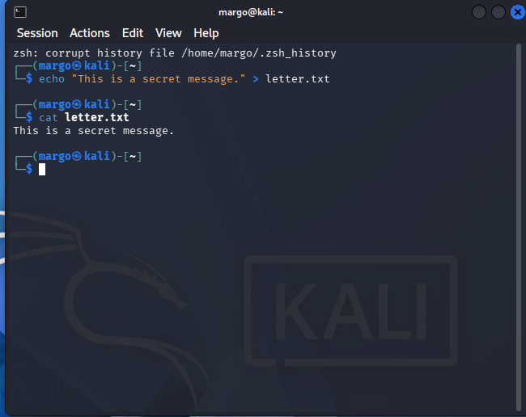
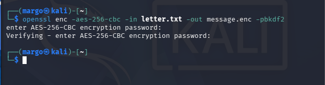
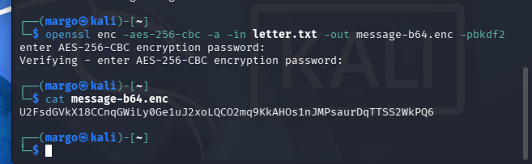
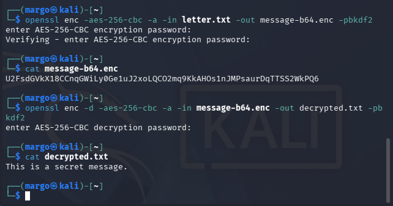

# Lab 02 — Data Encryption & Decryption Using OpenSSL

## Overview

This lab demonstrates symmetric encryption and decryption using OpenSSL with the AES-256-CBC algorithm. The objective was to understand how confidentiality is implemented using password-based encryption.

**Course:** Cisco CyberOps Associate  
**Environment:** Kali Linux (isolated lab environment) · OpenSSL 3.x · AES-256-CBC cipher

---

## Threat Scenario

Sensitive data is stored in plaintext and must be protected from unauthorised access. Encryption is applied to ensure confidentiality of the information during storage or transmission.

---

## Steps Performed

### Step 1 — Create Plaintext File

Created `letter.txt` containing sensitive data to be protected.

---

### Step 2 — Encrypt Using AES-256-CBC

Encrypted the file using AES-256-CBC, generating a binary encrypted file `message.enc`.

---

### Step 3 — Re-encrypt Using Base64

Re-encrypted the file with Base64 encoding for ASCII-safe output suitable for transmission.

---

### Step 4 — Decrypt and Verify

Decrypted the encrypted file back to plaintext and verified the content matched the original.

---

## Key Concepts Demonstrated

- Symmetric encryption
- AES-256-CBC cipher mode
- Password-based key derivation
- Base64 encoding for ASCII-safe output
- Salt usage in encryption
- Difference between encryption and hashing

---

## Result

The plaintext file was successfully encrypted and became unreadable without the correct password. Using the same password, the encrypted file was decrypted back to its original form — confirming correct implementation of symmetric encryption.

---

## Security Limitations

OpenSSL produced a warning indicating the use of a deprecated key derivation method. In production environments, stronger key derivation functions such as **PBKDF2** should be used.

Additionally, AES-256-CBC alone does not guarantee **data integrity** — encrypted data may still be modified without detection.

---

## Detection & Security Insight

Encryption ensures confidentiality but does not inherently provide integrity verification. Without additional mechanisms such as **HMAC** or authenticated encryption modes like **AES-GCM**, encrypted data remains vulnerable to undetected modification.

> **SOC relevance:** Understanding the difference between confidentiality and integrity is essential for correctly classifying security incidents and evaluating the effectiveness of encryption controls.
