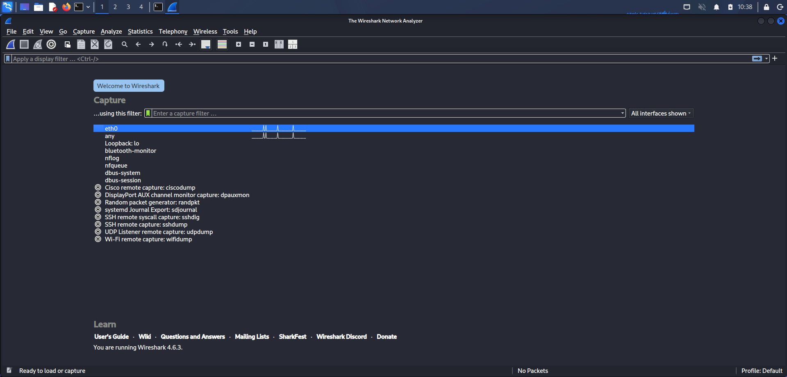
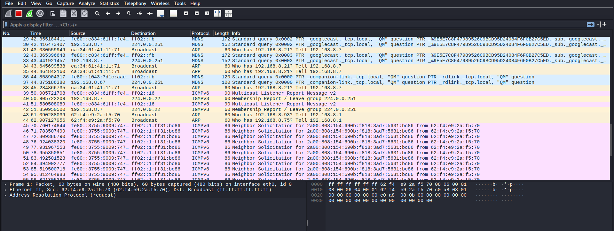
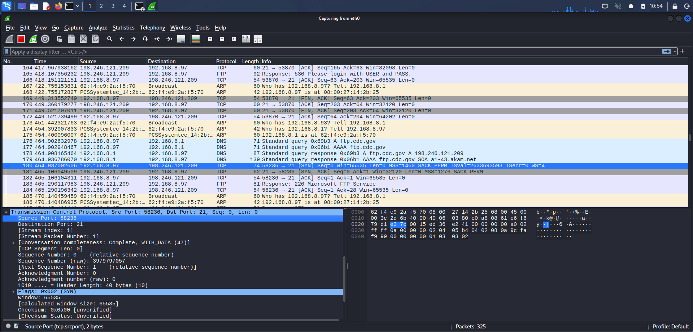
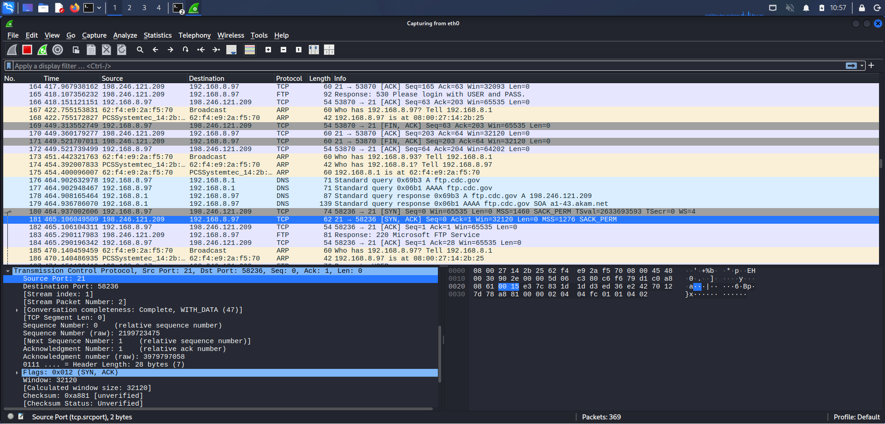
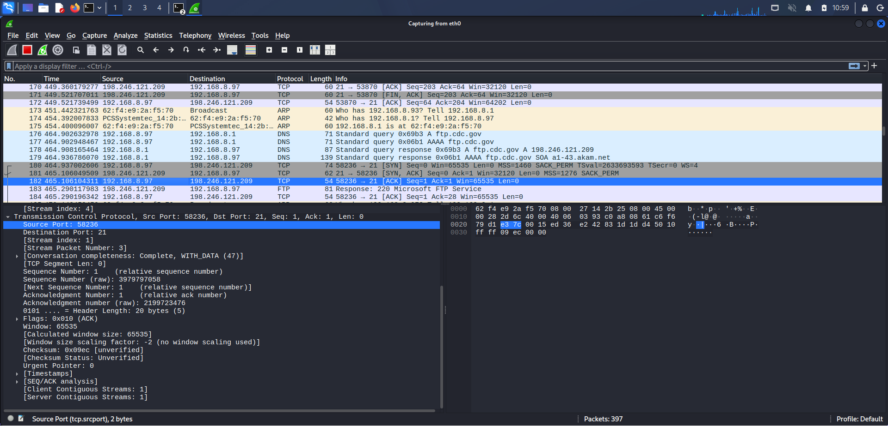
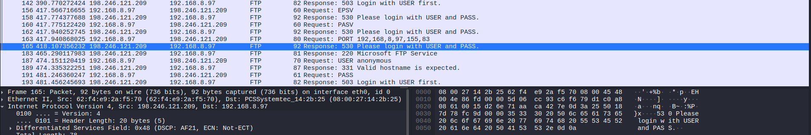
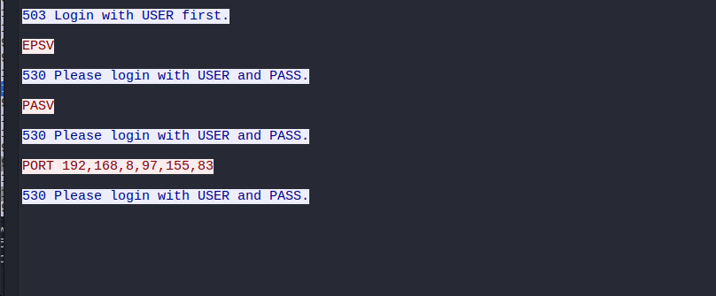
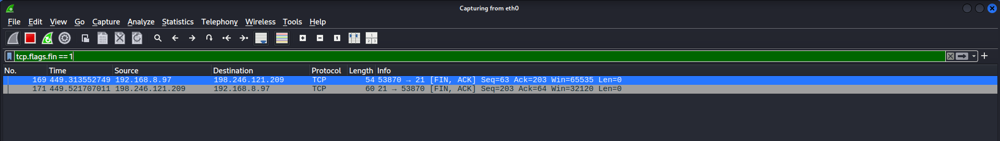
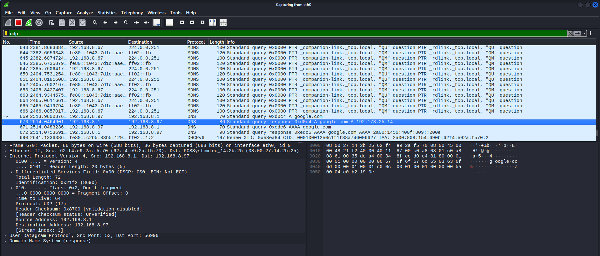

# Wireshark TCP and UDP Traffic Analysis

This lab demonstrates how to capture and analyze TCP and UDP traffic using Wireshark.

The objective was to observe how network communication works at the packet level and identify the behavior of TCP and UDP protocols.

---

# Step 1 — Selecting the Capture Interface

The first step was selecting the correct network interface in Wireshark.

In this case the **eth0 interface** was used to capture network traffic generated from the virtual machine.

---

# Step 2 — Starting Packet Capture

Packet capture was started in Wireshark in order to observe live network traffic.

During this phase Wireshark begins collecting packets transmitted through the network interface.

---

# Step 3 — TCP SYN Packet Analysis

This packet represents the **first step of the TCP three-way handshake**.

The client initiates communication with a SYN packet sent to the destination server.

### TCP Sequence and Acknowledgement Numbers

TCP uses **Sequence Numbers (Seq)** and **Acknowledgement Numbers (Ack)** to guarantee reliable communication.

During the TCP three-way handshake the following values can be observed:

SYN  
Client → Server  
Seq = X (Initial Sequence Number)  
Ack = 0

SYN-ACK  
Server → Client  
Seq = Y  
Ack = X + 1

ACK  
Client → Server  
Seq = X + 1  
Ack = Y + 1

Wireshark displays **relative sequence numbers by default**, which simplifies analysis.  
This means the first observed SYN packet is shown as **Seq = 0** instead of the actual random Initial Sequence Number.

Sequence and acknowledgement numbers ensure:

- packet ordering
- reliability
- detection of missing packets

---

# Step 4 — TCP SYN-ACK Packet

After the client sends the SYN packet, the server responds with a **SYN-ACK packet**.

This packet confirms that the server received the request and is ready to establish a connection.

The SYN-ACK packet contains both the **SYN flag** and the **ACK flag**, acknowledging the client's initial request.

---

# Step 5 — TCP ACK Packet

The final step of the **TCP three-way handshake** is the ACK packet sent by the client.

At this stage the connection between the client and server is successfully established.

Once the handshake is complete, application protocols such as **FTP** can begin transmitting data over the TCP connection.

---

# Step 6 — FTP Protocol Commands

After the TCP connection is established, the FTP protocol begins communication between the client and the server.

FTP uses **TCP port 21** for control communication. In this capture we can observe FTP commands and server responses such as:

- USER
- PASS
- EPSV
- PASV
- PORT

These commands are used to authenticate and establish data transfer channels.

### Active vs Passive FTP Modes

FTP can operate in two communication modes: **active mode** and **passive mode**.

Active mode (PORT command):
- the client opens a port
- the server initiates the data connection back to the client
- this mode can cause problems with NAT and firewalls

Passive mode (PASV or EPSV command):
- the server opens a port
- the client connects to the server for data transfer
- this mode works better with modern firewalls and NAT environments

In modern networks **passive mode (PASV / EPSV)** is recommended because it avoids inbound connection issues on the client side.

### FTP Security Observation

FTP transmits authentication credentials in **plain text**.

During packet inspection it is possible to observe commands such as:

USER username  
PASS password

This means that any attacker with network access could capture credentials using packet sniffing.

Security implications:

- credentials can be intercepted
- attackers could gain unauthorized access
- FTP is vulnerable to Man-in-the-Middle attacks

For secure environments FTP should be replaced with:

- **SFTP (SSH File Transfer Protocol)**
- **FTPS (FTP over TLS)**

- ### FTP Anonymous Login Observation

During packet analysis the FTP command **USER anonymous** can be observed.

Anonymous FTP allows users to access the FTP server without a personal account.  
While sometimes used for public file distribution, it can also introduce security risks.

Security considerations:

- anonymous login may allow unauthorized access
- attackers often scan for FTP servers with anonymous access
- exposed FTP services may lead to data leakage

In production environments anonymous FTP access should be carefully restricted or disabled.

---

# Step 7 — Following TCP Stream

Wireshark allows analysts to reconstruct a full communication session using the **Follow TCP Stream** feature.

This feature is extremely useful during incident response and network investigations because it allows analysts to observe the full conversation between a client and server.

In this case the FTP communication between the client and server can be reconstructed.

---

# Step 8 — TCP Session Termination

After data transmission is completed, the TCP session is closed using the **FIN flag**.

The FIN packet indicates that one side of the communication wants to terminate the connection.

In Wireshark we can observe the TCP termination process where both sides acknowledge the session closure.

### TCP Session Termination (4-Way FIN Process)

TCP connections are closed using a **four-step termination process**.

1. Client → FIN  
   The client indicates it wants to close the connection.

2. Server → ACK  
   The server acknowledges the request.

3. Server → FIN  
   The server also indicates it wants to close the connection.

4. Client → ACK  
   The client confirms the connection termination.

In Wireshark this sequence often appears as **[FIN, ACK] packets**.

Understanding this process is important for security analysis because abnormal termination patterns such as **RST packets instead of FIN packets** may indicate:

- session hijacking attempts
- scanning activity
- abnormal application behavior

---

# Step 9 — UDP DNS Packet Analysis

Unlike TCP, UDP is a **connectionless protocol**. It does not establish a session before sending data.

In this capture we observe a **DNS query and response** transmitted using UDP on port **53**.

UDP is commonly used for DNS because it provides faster communication without the overhead of connection establishment.

### DNS Query and Response Analysis

In the captured packet we can observe a DNS request and response.

Example:

Query:
google.com

Response:
A record → 192.178.25.14

DNS operates using **Transaction IDs** which allow the client to match responses with queries.

Important DNS header fields include:

- QR (Query/Response)
- Opcode
- AA (Authoritative Answer)
- RD (Recursion Desired)
- RA (Recursion Available)
- RCODE (Response code)

DNS traffic analysis is important because attackers may attempt:

- DNS spoofing
- DNS cache poisoning
- malicious domain resolution
- ### DNS Response Verification

In the captured DNS response the domain **google.com** resolves to:

192.178.25.14

In real security investigations analysts must verify whether the returned IP address actually belongs to the expected organization.

This verification helps detect attacks such as:

- DNS spoofing
- DNS cache poisoning
- malicious redirection

For example, legitimate Google IP ranges typically belong to the **AS15169 Google network**.

Validating DNS responses against known IP ranges or threat intelligence sources is a common task for SOC analysts.

---
## Wireshark Display Filters Used

During analysis several Wireshark display filters were used:

tcp.flags.syn == 1 && tcp.flags.ack == 0  
Shows only initial SYN packets

tcp.flags.fin == 1  
Shows TCP session termination

ftp  
Filters FTP protocol traffic

dns  
Shows DNS queries and responses

tcp.stream eq 4  
Shows packets belonging to a specific TCP stream

---

# Security Analysis Summary

This lab demonstrates how Wireshark can be used to analyze network traffic and understand how protocols operate at different layers of the network stack.

Key observations:

- TCP uses a **three-way handshake** to establish reliable connections.
- FTP communication operates over **TCP port 21**.
- TCP sessions are properly terminated using **FIN packets**.
- DNS traffic commonly uses **UDP port 53**.
- Wireshark provides powerful capabilities for analyzing packet headers, protocol behavior, and network communication patterns.

Understanding these patterns is essential for **Security Operations Center (SOC) analysts**, incident responders, and network defenders who investigate suspicious traffic and network anomalies.

---

## Security Analyst Perspective

When analyzing network captures, security analysts look for suspicious patterns such as:

- unusual destination IP addresses
- high numbers of retransmissions
- abnormal DNS queries
- unexpected protocols
- port scanning behaviour

Identifying these anomalies is essential for detecting potential intrusions or compromised systems.

---

## Additional Wireshark Analysis Techniques

Professional network analysts often use additional Wireshark tools to better understand network traffic patterns.

Some useful analysis features include:

**Protocol Hierarchy**

Statistics → Protocol Hierarchy

This view helps identify which protocols dominate the captured traffic.  
It provides a quick overview of protocol distribution within the capture.

**Conversations**

Statistics → Conversations

This feature helps identify which hosts communicate the most within the network capture and can reveal suspicious communication patterns.

**I/O Graph**

Statistics → I/O Graph

This tool visualizes traffic over time and can help analysts detect spikes in traffic, anomalies, or unusual bursts of network activity.

These tools are commonly used by **SOC analysts and incident responders** when investigating network captures.
