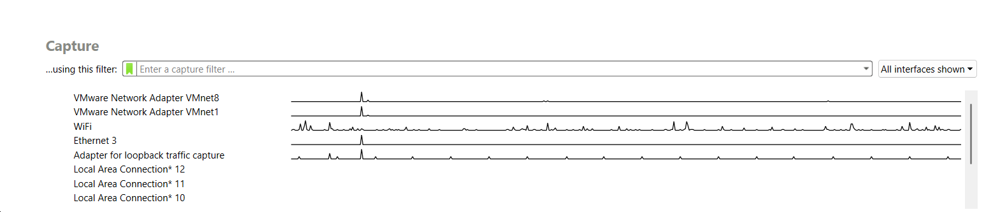
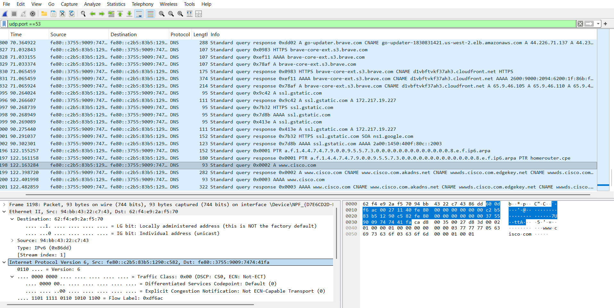

# Lab 04 – DNS Traffic Analysis with Wireshark

**Course:** Cisco CyberOps Associate  
**Lab source:** Cisco Networking Academy – Exploring DNS Traffic  
**Tool:** Wireshark  
**Environment:** Windows 11

---

## Tools Used

- Wireshark
- Windows Command Prompt
- nslookup

---

## Wireshark Capture Interface

Wireshark was started and the active network interface was selected to capture traffic.



---

## Generating DNS Traffic

Before capturing traffic in Wireshark, DNS queries were generated using the Windows
Command Prompt. The DNS cache was cleared to force the system to perform a new DNS lookup.

```cmd
ipconfig /flushdns
nslookup www.cisco.com
```


---

## Capturing DNS Traffic

With the DNS cache cleared, Wireshark was started and traffic capture was initiated
before running the nslookup command. This ensured that a fresh DNS request would
appear in the packet capture.


---

## Filtering DNS Packets

Initially the following Wireshark display filter was used:


```
udp.port == 53
```

This filter shows DNS traffic transported over **UDP**, which is the most common
transport protocol for DNS queries.

However, Wireshark also provides a more general filter:

```
dns
```
The `dns` filter displays all DNS traffic regardless of the transport protocol,
including DNS over **UDP** as well as DNS over **TCP** (which can occur during zone
transfers or large DNS responses).

For this lab, `udp.port == 53` was sufficient because the captured traffic consisted
of standard DNS queries and responses.


---

## Wireshark DNS Filters

| Filter | What it shows | Use case |
|--------|--------------|----------|
| `dns` | All DNS traffic (UDP + TCP) | Recommended general DNS analysis filter |
| `udp.port == 53` | DNS over UDP only | Standard DNS queries |
| `dns.flags.response == 0` | DNS queries only | Investigating client requests |
| `dns.flags.rcode != 0` | DNS errors | Troubleshooting NXDOMAIN or failures |

---

## DNS Query Packet Structure

The DNS query packet contains multiple protocol layers:

- Ethernet
- Internet Protocol (IPv6)
- User Datagram Protocol (UDP)
- Domain Name System (DNS)

### DNS Query Packet Fields

| Field | Value | Description |
|-------|-------|-------------|
| Transaction ID | `0x0002` | Unique identifier for the DNS query |
| Query Name | `www.cisco.com` | Requested domain |
| Query Type | `AAAA (28)` | Request for IPv6 address |
| Flags | `0x0100` | Standard query, recursion desired |
| Questions | `1` | One DNS question |


---

## IP Layer Analysis

The Internet Protocol layer shows the source and destination IP addresses involved
in the DNS communication.



### IPv4 vs IPv6 Observation

During the packet inspection, both IPv4 and IPv6 addresses were observed in the DNS
responses. The DNS response included IPv6 records (AAAA records) as well as IPv4
addresses.

IPv6 is increasingly used by modern web services because it provides a much larger
address space and improved routing efficiency compared to IPv4.

In this capture, the client requested an IPv6 address for `www.cisco.com`. Modern
operating systems typically send both A and AAAA queries simultaneously (DNS Happy
Eyeballs behaviour). If a valid AAAA response is received, IPv6 connectivity is used;
otherwise IPv4 is used as fallback.

---

## UDP Transport Layer

DNS queries are typically transmitted using **UDP port 53**. UDP is preferred over TCP
for standard DNS queries because it is connectionless and faster — the small size of
DNS packets makes the reliability overhead of TCP unnecessary.


---

## DNS Response Records

The DNS response reveals a chain of **CNAME records** before resolving to the final address.

www.cisco.com
  → CNAME → www.cisco.com.akadns.net
  → CNAME → wwds.cisco.com.edgekey.net
  → CNAME → wwwds.cisco.com.edgekey.net.globalredir.akadns.net
  → CNAME → e2867.dsca.akamaiedge.net
  → AAAA  → 2a02:26f0:e2:784::b33
  → AAAA  → 2a02:26f0:e2:788::b33
  → A     → 23.32.26.4


The final records may vary depending on resolver, time, and geographic location.
This multi-level CNAME chain is typical of **Akamai CDN infrastructure**, which
dynamically routes traffic to the nearest edge server for load balancing and
geographic optimisation — confirming that Cisco relies on Akamai for content delivery.


---

## Detailed DNS Packet Analysis

To better understand the DNS protocol, one DNS query and one DNS response packet
were examined in detail using Wireshark.

### DNS Query Packet

The DNS query packet for `www.cisco.com` contained the following key values:

- **Transaction ID:** `0x0002`
- **Query Type:** `AAAA (28)` — IPv6 address request
- **Query Name:** `www.cisco.com`
- **Questions:** `1`
- **Answers:** `0`
- **Flags:** `0x0100` — Standard query, recursion desired (RD=1)

This query was sent from the client to the DNS server using **UDP port 53**.

### DNS Response Packet

The DNS response packet returned multiple records with the following key fields:

- **Flags:** `0x8180` — Standard query response, No error (RCODE=0)
- **Questions:** `1`
- **Answer RRs:** `6`
- **Authority RRs:** `0`
- **Additional RRs:** `0` — no glue records were included; all returned information
was contained within the Answer section

The six Answer RRs consisted of a chain of **CNAME records** resolving to the final
IPv6 address, as documented in the DNS Response Records section above.

The response also included **TTL values** for each record, defining how long each
entry can be cached by the client. Notably, the edge server AAAA records carried a
TTL of only 20 seconds, allowing Akamai to dynamically redirect traffic across edge nodes.

---

## Security Perspective

During the packet capture, only legitimate and commonly used domains were observed,
including google.com, cisco.com, and brave.com. No suspicious domain patterns were
identified — such as long randomised subdomains or unusually high query volumes —
which could otherwise indicate techniques like **DNS tunnelling** or data exfiltration.
The observed traffic appears to represent normal client behaviour driven by standard
web browsing and background software update activity.

From a defensive standpoint, Wireshark can be used to detect abnormal DNS behaviour
by analysing query frequency, response codes, and domain entropy. Tools such as
**Wireshark Statistics → DNS** and **Expert Information** are particularly useful
for surfacing:

- unusually high DNS query rates, which may indicate beaconing or DGA activity
- repeated NXDOMAIN responses, which can signal domain enumeration or misconfigured malware
- domains with randomised subdomain structures, a common characteristic of DNS
tunnelling and C2 communication

It is also worth noting that all DNS traffic captured in this lab used **traditional
unencrypted DNS over UDP (port 53)**, which allows passive monitoring and full query
visibility. Modern systems increasingly adopt encrypted alternatives —
**DNS-over-HTTPS (DoH, port 443)** and **DNS-over-TLS (DoT, port 853)** — which
protect user privacy by preventing interception. However, this encryption comes at a
cost to defenders: without endpoint-level DNS logging or dedicated DoH/DoT inspection
capabilities, encrypted DNS significantly reduces network visibility and complicates
threat detection.

---

## Reflection — UDP vs TCP for DNS

UDP is preferred over TCP as the transport protocol for DNS for several reasons:

**Speed** — UDP is connectionless, meaning no handshake is required before sending
a query. A DNS transaction completes in a single round trip (query + response),
whereas TCP requires a three-way handshake before any data is exchanged.

**Low overhead** — DNS query and response packets are small (typically under 512
bytes). The additional reliability mechanisms in TCP (sequencing, acknowledgements,
retransmission) add unnecessary overhead for such small payloads.

**Scalability** — DNS servers handle millions of queries per second. The stateless
nature of UDP allows DNS servers to process queries without maintaining connection
state for each client, making the infrastructure significantly more scalable.

**Sufficient reliability** — If a DNS response is lost, the client simply retries
the query. This application-layer retry mechanism is adequate for DNS without
requiring TCP's built-in reliability.

TCP is used for DNS only in specific cases — such as zone transfers between DNS
servers or when a response exceeds 512 bytes and cannot fit in a single UDP packet.

---

## Conclusion

This lab demonstrated how DNS traffic can be captured and analysed using Wireshark
to gain practical insight into one of the internet's most fundamental protocols.

By examining individual packet structure — from the Ethernet frame through IPv6 and
UDP layers down to the DNS payload — it becomes clear how domain names are resolved
into IP addresses and how large-scale services leverage CDN infrastructure such as
Akamai to distribute traffic across global edge nodes.

Because DNS is involved in nearly every network connection, it is a high-signal source
of threat intelligence. DNS logs can expose early indicators of compromise, including
suspicious or newly registered domains, command-and-control (C2) beaconing, DNS
tunnelling, and domain generation algorithm (DGA) activity used by malware to evade
static blocklists. This is why DNS monitoring is a core component of modern SOC
workflows and SIEM platforms such as Splunk, Elastic, and Microsoft Sentinel — where
DNS telemetry is routinely correlated with endpoint and network data to detect lateral
movement and data exfiltration attempts.

---

*Cisco CyberOps – Practical Lab Implementation*
