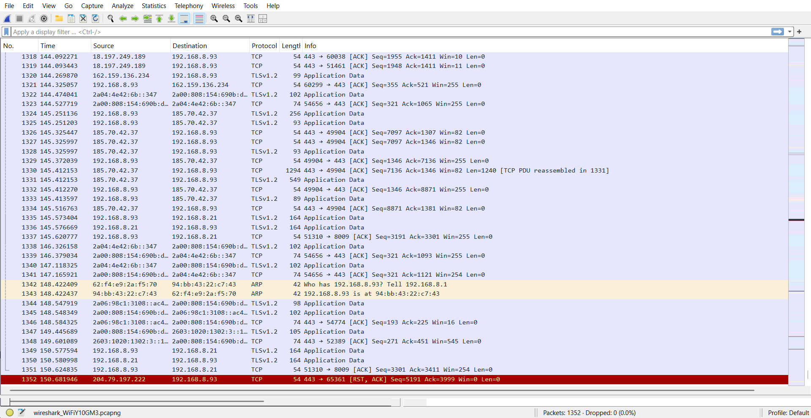
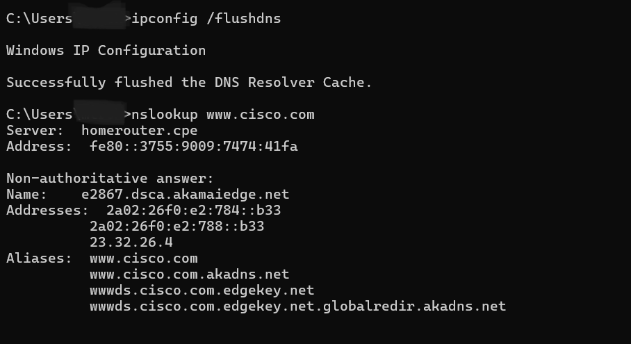
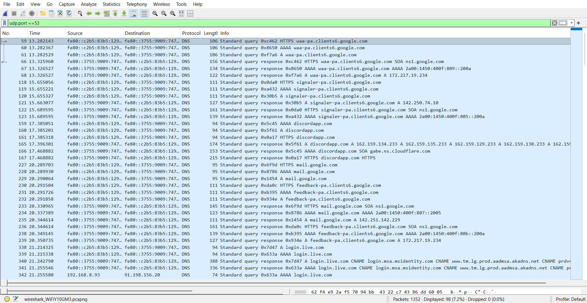
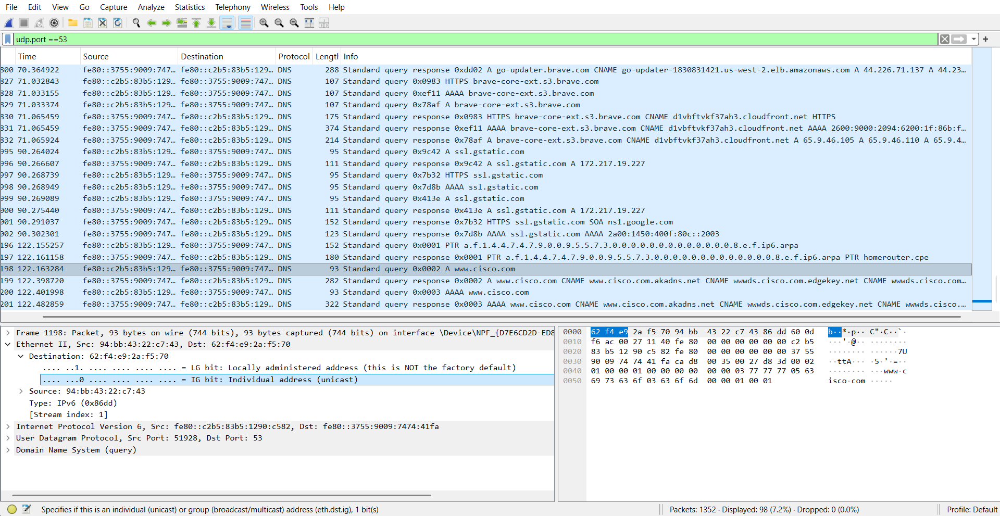
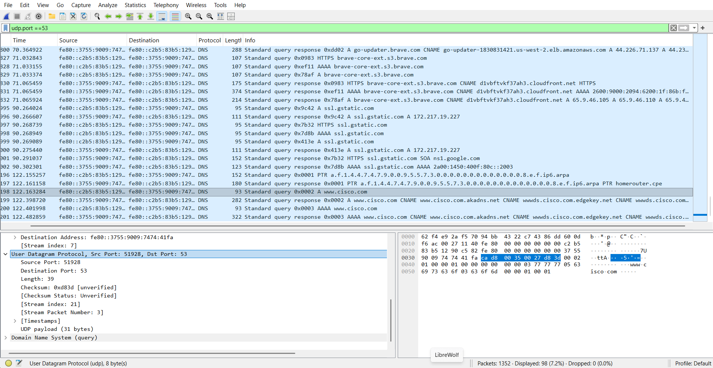
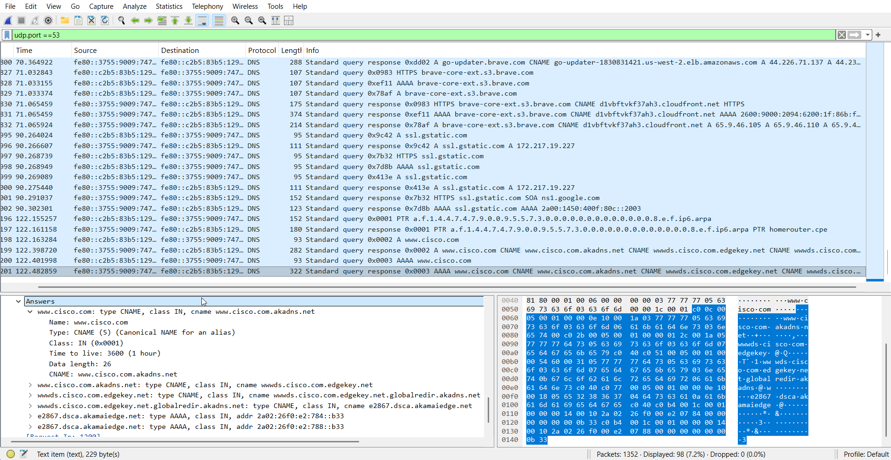

# DNS Traffic Analysis with Wireshark

This lab demonstrates how DNS traffic can be captured and analyzed using Wireshark.  
The goal was to observe how domain names resolve to IP addresses and examine the structure of DNS packets.

Lab source: Cisco Networking Academy – Exploring DNS Traffic

---

## Tools Used

- Wireshark
- Windows Command Prompt
- nslookup

---

## Wireshark Capture Interface

Wireshark was started and the active network interface was selected to capture traffic.

---

## Generating DNS Traffic

Before capturing traffic in Wireshark, DNS queries were generated using the Windows Command Prompt.

The DNS cache was cleared to force the system to perform a new DNS lookup.

## Capturing DNS Traffic
This ensured that a fresh DNS request would appear in the packet capture.

These commands forced the system to perform a new DNS lookup.

---

## Filtering DNS Packets

To isolate DNS traffic, the following display filter was applied:

This filter displays only DNS packets.

---

## DNS Query Packet Structure

The DNS query packet contains multiple protocol layers:

- Ethernet
- Internet Protocol (IPv6)
- User Datagram Protocol (UDP)
- Domain Name System (DNS)

---

## IP Layer Analysis

The Internet Protocol layer shows the source and destination IP addresses involved in the DNS communication.

---

## UDP Transport Layer

DNS queries are typically transmitted using **UDP port 53**.

---

## DNS Response Records

The DNS response reveals a chain of **CNAME records** before resolving to the final address.

Example resolution chain:

This shows that Cisco uses **Akamai CDN infrastructure**.

---
## Detailed DNS Packet Analysis

To better understand the DNS protocol, one DNS query and one DNS response packet were examined in detail using Wireshark.

### DNS Query Packet

The DNS query packet contained the following key values:

- **Query type:** AAAA (IPv6 address request)
- **Questions:** 1
- **Answers:** 0
- **Flags:** Standard query

The client requested the IPv6 address for:

This query was sent from the client to the DNS server using **UDP port 53**.

---

### DNS Response Packet

The DNS response packet returned multiple records.

Key fields observed:

- **Flags:** Standard query response (No error)
- **Questions:** 1
- **Answer RRs:** 6
- **Authority RRs:** 0
- **Additional RRs:** 0

The response contained a chain of **CNAME records** before resolving to the final IPv6 address.

Example chain observed:

This behavior is typical for large web services that use **Content Delivery Networks (CDN)** such as Akamai.

The DNS records also included **TTL values**, which define how long the response can be cached by the client.

## Security Perspective

DNS traffic analysis helps security analysts:

- detect suspicious domains
- identify command-and-control communication
- investigate external connections
- understand network behavior

Monitoring DNS activity is an important part of network security and threat detection.

---

## Conclusion

This lab demonstrated how DNS queries and responses can be captured and analyzed using Wireshark.  
Understanding DNS traffic is essential for both network troubleshooting and cybersecurity analysis.

