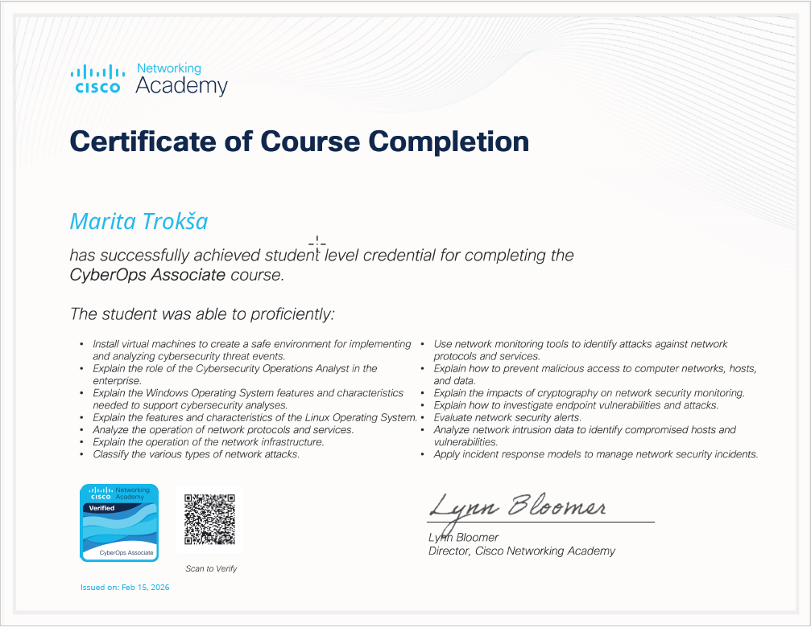

# Cisco Networking Academy – CyberOps Associate

https://www.credly.com/badges/4f2553b4-fcca-4eb8-aa6a-081846c92520/public_url

**Issuer:** Cisco Networking Academy  |  **Issued:** 2026  |  **Level:** Associate

---

## Overview

Completed Cisco CyberOps Associate training focused on Security Operations Center (SOC) fundamentals, covering threat detection, network analysis and incident response.

## Core Topics Covered

- Security monitoring concepts
- Network traffic analysis
- Intrusion detection systems (IDS)
- Incident response models
- Log analysis and investigation
- Threat detection techniques

## Practical Skills Developed

- Packet analysis basics
- Identifying suspicious network behaviour
- Understanding SOC workflows
- Security event investigation methodology

---

## Practical Labs

All labs completed as part of this course are documented in the Cisco CyberOps Labs repository.

| Lab | Topic | Link |
|---|---|---|
| Lab 01 | File Integrity & Hash Verification | [View](../../Cisco-CyberOps-Labs/Lab-01-File-Integrity) |
| Lab 02 | Encryption with OpenSSL | [View](../../Cisco-CyberOps-Labs/Lab-02-Encryption-with-OpenSSL) |
| Lab 03 | Wireshark TCP/UDP Analysis | [View](../../Cisco-CyberOps-Labs/Lab-03-Wireshark-TCP-UDP-Analysis) |
| Lab 04 | DNS Traffic Analysis | [View](../../Cisco-CyberOps-Labs/dns-traffic-analysis) |

→ [View all Cisco CyberOps Labs](../../Cisco-CyberOps-Labs)
