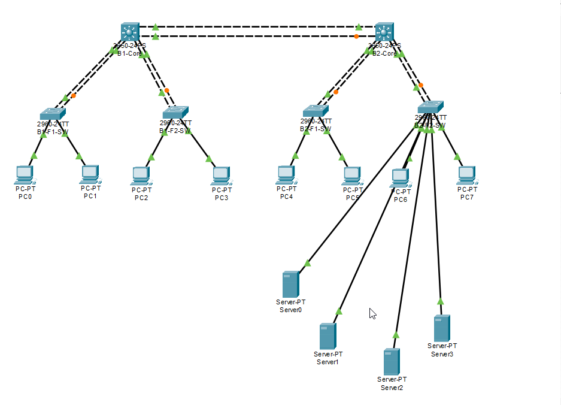

# Lab 01 — Enterprise Network Security

**Course:** CyberStart — Network Security Module  
**Tool:** Cisco Packet Tracer  
**Completed:** April 2026

---

## Scenario

A company relocating to a new office across two buildings 
needed a professionally designed, secure, and redundant 
enterprise network. Built from a realistic business brief 
provided by the instructor.

> *"Please build something segmented, secure, redundant, 
> manageable, and not embarrassing."*

---

## Network Topology

---

## What Was Built

| Component | Details |
|-----------|---------|
| Buildings | 2 |
| Core Switches | 2x Cisco 3650-24PS (L3) |
| Floor Switches | 4x Cisco 2960-24TT (L2) |
| End Users | 8 PCs across 6 departments |
| Servers | 4 (DNS/DHCP, HTTP, NTP, FTP) |
| VLANs | 9 (including Management and Parking) |

---

## VLAN Design

| VLAN | Department | Subnet |
|------|-----------|--------|
| 10 | HR | 192.168.1.0/24 |
| 20 | Finance | 192.168.2.0/24 |
| 30 | IT | 192.168.3.0/24 |
| 40 | Admins | 192.168.4.0/24 |
| 50 | ConstructionProject | 192.168.5.0/24 |
| 60 | CyberStart | 192.168.6.0/24 |
| 70 | Servers | 192.168.10.0/25 |
| 99 | Management | 192.168.100.0/24 |
| 999 | Parking | — |

---

## Security Implementation

### Access Control (ACL)
- Admins — full access everywhere
- HR ↔ Finance — can reach each other only
- HR & Finance — blocked from HTTP
