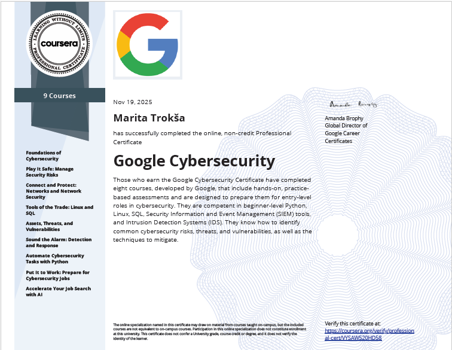

# Google Cybersecurity Professional Certificate

https://www.credly.com/badges/754d58e3-3df9-45dd-8850-87be30793e7a/public_url

**Issuer:** Google / Coursera  |  **Issued:** 2025  |  **Level:** Entry-level

---

## Overview

Comprehensive cybersecurity training covering security operations, risk management, and incident response aligned with NIST frameworks.

## Core Topics

- NIST Cybersecurity Framework
- Risk assessment methodology
- SIEM fundamentals
- Log analysis basics
- Incident response lifecycle

## Hands-on Practice

- Security audit exercises
- Risk register development
- Incident analysis scenarios
- Log investigation labs

---

## Course Projects

### Vulnerability Assessment Report — Active Directory Lab

Risk assessment of a Windows Server 2019 Active Directory Domain Controller 
using NIST SP 800-30 Rev. 1. Identifies five threat scenarios including brute 
force attacks, privilege escalation, and lateral movement. Defines a 
remediation strategy covering GPO password policies, account lockout 
configuration, RBAC implementation, and legacy cryptography hardening.

**Topics:** NIST SP 800-30 · Active Directory · Risk assessment · 
Remediation · Access controls · Group Policy

> 📄 [View PDF](./vulnerability-assessment-report-ad-lab.pdf)
---

### Internal Security Audit — Botium Toys

Internal security audit of a fictional U.S. retail company conducted 
using NIST CSF. Evaluates 14 security controls and assesses compliance 
against PCI DSS, GDPR, and SOC 1/2 standards. Identifies critical gaps 
including missing encryption, lack of least privilege, no IDS, and 
absent disaster recovery plans. Risk score: 8/10.

**Topics:** Internal audit · PCI DSS · GDPR · SOC · Controls 
assessment · Compliance · Risk scoring

> 📄 [View PDF](./Botium_Toys_Internal_Audit_Report.pdf)

---

### Security Risk Assessment Report
Hardening recommendations for an organisation with identified authentication and network vulnerabilities. Analyses three controls — MFA, password policies, and firewall maintenance — and justifies their implementation against brute force, credential abuse, and DoS threats.

**Topics:** System hardening · MFA · Password policy · Firewall management · Risk mitigation

> 📄 [View PDF](./Security_Risk_Assessment_Report_FINAL.pdf)

