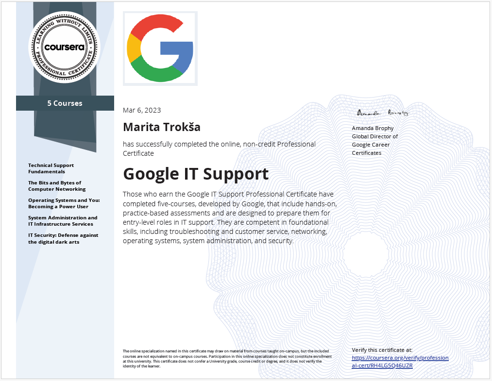

# Google IT Support Professional Certificate

https://www.credly.com/badges/708d47b6-a837-4467-bfe6-3770e3d1cd3e/public_url

**Issuer:** Google / Coursera  |  **Issued:** 2023  |  **Level:** Entry-level

---

## Overview

Completed foundational training in IT support covering networking, operating systems, system administration, IT security and troubleshooting methodology.

## Key Skills Developed

- TCP/IP and networking concepts
- Linux command line basics
- Active Directory fundamentals
- Security best practices
- Incident troubleshooting

## Practical Components

- Hands-on labs
- Technical troubleshooting scenarios
- Basic security and risk awareness

---

## Course Project

Security Infrastructure Design Document — a full security architecture plan for a fictional e-commerce organisation covering authentication, firewall rules, VLAN configuration, wireless security, laptop hardening, IDS and privacy policy recommendations.

> 📄 Security Infrastructure Design → [View PDF](./security-infrastructure-design.pdf)
