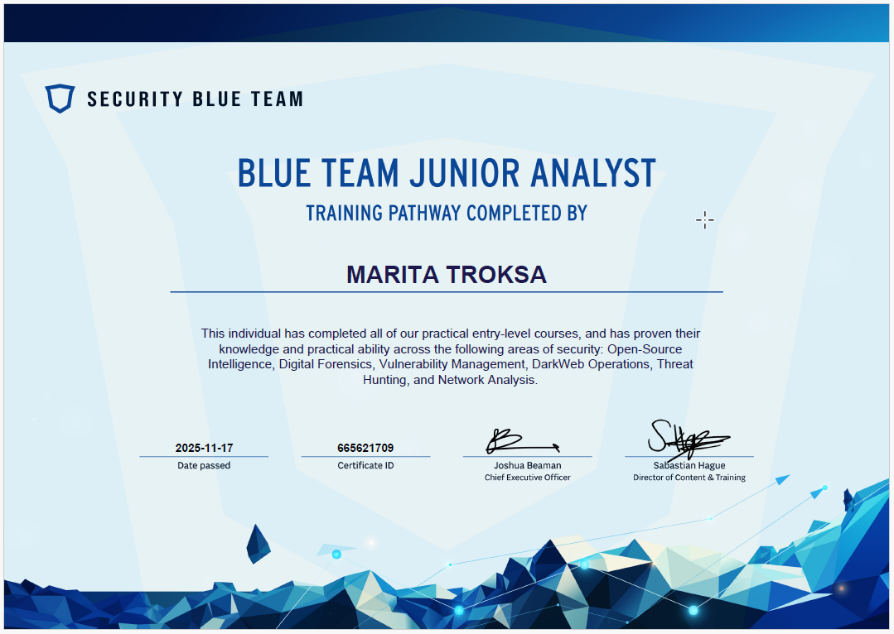

# Security Blue Team – Junior Analyst Pathway

**Issuer:** Security Blue Team | **Issued:** 2025-11-17 | **Level:** Entry-level

---

## Overview

Completed all practical entry-level courses in the Junior Analyst Pathway, demonstrating knowledge and hands-on ability across core blue team disciplines.

## Areas Covered

- Open-Source Intelligence (OSINT)
- Digital Forensics
- Vulnerability Management
- Dark Web Operations
- Threat Hunting
- Network Analysis

## Skills Demonstrated

- Practical blue team investigation techniques
- Threat actor research and OSINT methodology
- Network traffic and log analysis
- Vulnerability identification and reporting
