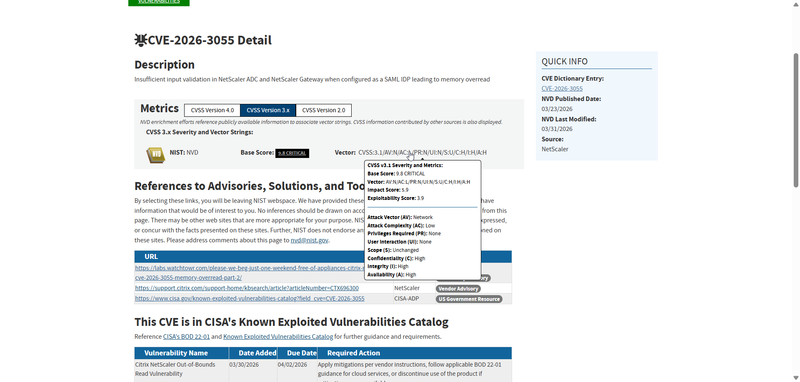
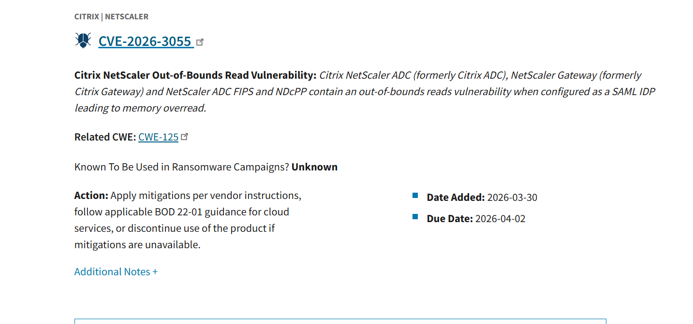
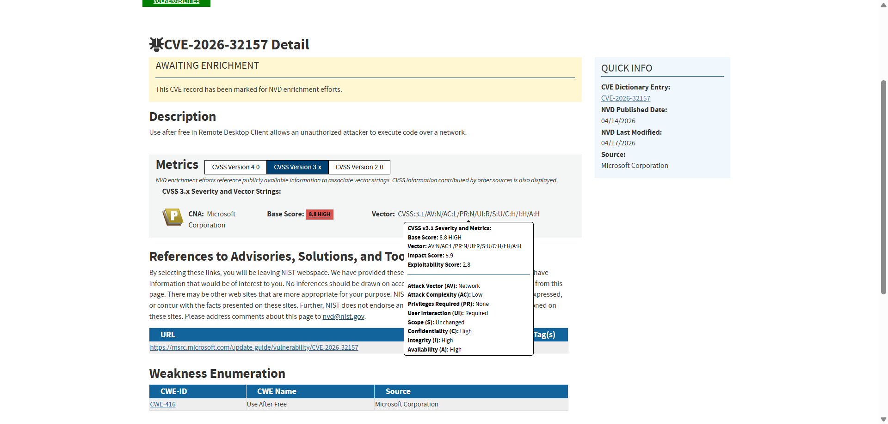
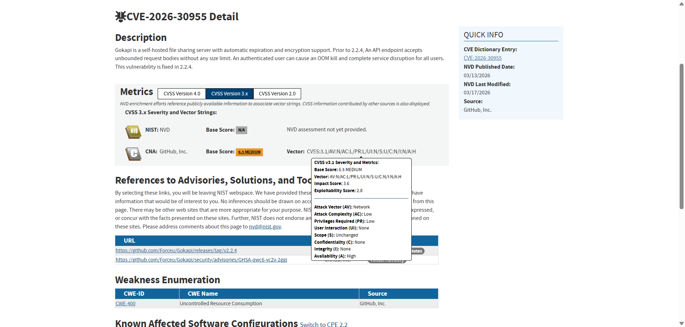

# Vulnerability Assessment — DataBridge IT Services

## Project Overview

This project simulates a real-world CVE vulnerability assessment and risk analysis for a fictional IT services company, DataBridge. The scenario covers vulnerability identification, risk scoring, remediation planning, and executive reporting.

> **Note:** DataBridge is a fictional company created for educational and portfolio purposes. All CVE data is based on real published vulnerabilities.

**Date:** April 2026  
**Type:** Vulnerability Assessment / Risk Analysis  
**Methodology:** CVSS v3.1 scoring · Risk matrix · Remediation prioritisation

---

## Scenario — DataBridge IT Services

| Field | Details |
|---|---|
| Industry | IT services and business system maintenance |
| Employees | 48 |
| Location | 1 office in Riga, partial remote workforce |
| Clients | Small and medium enterprises in Latvia |
| Services | Server maintenance, cloud administration, email and file sharing, web hosting, remote access |

**Infrastructure:**
- 28 Windows 11 workstations
- 4 legacy Windows 10 workstations (specialised software)
- 6 virtual servers (VMware/Proxmox)
- 2 Linux servers (internal systems)
- 1 publicly accessible file sharing server (Gokapi 2.2.3)
- 1 public-facing website
- VPN gateway (NetScaler Gateway) for remote access
- Backup server
- Google Workspace + Microsoft 365 (mixed environment)
- Centralised log management and antivirus

---

## CVEs Assessed

| CVE | Affected System | CVSS Score | Severity |
|---|---|---|---|
| CVE-2026-32157 | Microsoft Remote Desktop Client | 8.8 | HIGH |
| CVE-2026-30955 | Gokapi File Sharing Server (< 2.2.4) | 6.5 | MEDIUM |
| CVE-2026-3055 | Citrix NetScaler ADC / Gateway (SAML IDP) | 9.8 | CRITICAL |

---

## Task 1 — Applicability Assessment

| CVE | Affected Asset | Applies to Company? | Attack Vector | Requires Auth? | Actively Exploited? |
|---|---|---|---|---|---|
| CVE-2026-32157 | Microsoft Remote Desktop Client | Yes — employees use RDP daily | Network | No | No |
| CVE-2026-30955 | Gokapi 2.2.3 file sharing server | Yes — publicly accessible, vulnerable version | Network | Low (authenticated user) | No |
| CVE-2026-3055 | NetScaler Gateway VPN | Yes — internet-facing, configured as SAML IDP | Network | None | Yes — CISA KEV |

---

## Task 2 — Risk Analysis

### CVE-2026-3055 — Citrix NetScaler Gateway (CRITICAL)

| Field | Details |
|---|---|
| How exploited | Unauthenticated attacker sends malformed HTTP request to NetScaler SAML IDP endpoint, causing memory overread. Attacker may gain full system access or impersonate any user via forged SAML assertions — no credentials required. |
| Potential consequences | VPN service disruption · Unauthorised access to internal network · Lateral movement to all internal systems · Client data exfiltration · Complete network compromise |
| Existing controls | Centralised log management · Antivirus · VPN as primary remote access gateway |
| Additional controls needed | Apply Citrix patch immediately · Deploy IDS/IPS in front of NetScaler · Implement Conditional Access Policy (MFA for high-risk sign-ins) · Network segmentation · Monitor NetScaler logs in SIEM · Review all active sessions |

---

### CVE-2026-32157 — Microsoft Remote Desktop Client (HIGH)

| Field | Details |
|---|---|
| How exploited | Attacker sets up a malicious RDP server. When an employee connects, a Use After Free memory vulnerability allows remote code execution on the client machine. Requires user interaction — employee must connect to attacker-controlled server. |
| Potential consequences | Remote code execution on employee device · Lateral movement to client systems · Data exfiltration · Supply chain risk — compromised employee can reach client infrastructure |
| Existing controls | Antivirus · Centralised logging · VPN |
| Additional controls needed | Apply Microsoft security patch immediately · Deploy RDP gateway or Azure Bastion · User awareness training · Monitor RDP connection logs in SIEM · Implement Conditional Access Policy |

---

### CVE-2026-30955 — Gokapi 2.2.3 (MEDIUM)

| Field | Details |
|---|---|
| How exploited | Authenticated user sends oversized API request with no server-side size limit. Server exhausts available memory (OOM Kill), causing complete service disruption. Public registration may allow any attacker to create an account. |
| Potential consequences | File sharing service unavailable · Business operations disrupted · Client file transfers blocked · Potential for repeated DoS attacks |
| Existing controls | Antivirus · Centralised logging |
| Additional controls needed | Patch Gokapi to version 2.2.4 · Deploy WAF with rate limiting · Restrict or disable public user registration · Monitor upload size anomalies in SIEM · Implement ACL |

---

### Risk Matrix

| CVE | Likelihood (1–3) | Impact (1–3) | Risk Score | Risk Level |
|---|---|---|---|---|
| CVE-2026-32157 | 3 | 2 | 6 | High |
| CVE-2026-30955 | 2 | 2 | 4 | Medium |
| CVE-2026-3055 | 3 | 3 | 9 | Critical |

> Formula: Risk = Likelihood × Impact · Scale: 1–2 Low · 3–4 Medium · 6 High · 9 Critical

---

## Task 3 — Remediation Plan

### Immediately (0 days)

**CVE-2026-3055 — NetScaler Gateway (CRITICAL — actively exploited)**
- Apply Citrix security patch immediately after rapid testing
- If patch unavailable — isolate NetScaler from internet as temporary measure
- Review NetScaler logs for signs of existing compromise
- Notify all remote employees of potential VPN disruption
- Notify management — critical risk, immediate action required

**CVE-2026-32157 — Remote Desktop Client (HIGH)**
- Apply Microsoft security patch immediately
- Send user awareness alert — do not connect to unknown RDP servers
- Review RDP connection logs for suspicious activity

### Within 7 Days

**CVE-2026-30955 — Gokapi (MEDIUM)**
- Patch Gokapi to version 2.2.4 after testing in staging environment
- Temporarily restrict public registration until patch is applied
- Configure WAF rate limiting as additional protection layer

**All vulnerabilities:**
- Implement Conditional Access Policy with MFA for high-risk sign-ins
- Review and update firewall and ACL rules
- Verify backup integrity — ensure rollback is possible if patch causes issues

### Within 30 Days
- Deploy IDS/IPS solution in front of internet-facing systems
- Implement network segmentation — limit lateral movement between systems
- Conduct user awareness training focused on RDP and phishing risks
- Review patch management process — establish regular maintenance windows
- Integrate all three systems into SIEM monitoring with alerting rules
- Consider Azure Bastion or equivalent RDP gateway to eliminate direct RDP exposure
- Review least privilege access across all systems

---

## Task 4 — Executive Summary

| Field | Details |
|---|---|
| Priority risk | CVE-2026-3055 — Citrix NetScaler Gateway (CVSS 9.8 Critical) |
| Justification | The VPN gateway is publicly accessible, requires no authentication to exploit, and is actively being used in real-world attacks according to CISA. An attacker can gain full access to the internal network without any credentials. |
| Business impact | Remote employees lose access to business systems · Internal network and client data exposed · Potential GDPR consequences if client data is compromised · Direct financial loss from service disruption |
| Recommended immediate action | Apply Citrix security patch today. If patch is unavailable, temporarily isolate NetScaler from the internet. Enable MFA via Conditional Access Policy. Review logs immediately for signs of existing compromise. |

---

## Skills Demonstrated

CVE analysis · CVSS v3.1 scoring · Risk matrix · Vulnerability assessment · Remediation planning · Executive reporting · NVD / NIST · CISA KEV · Patch management · Defence in depth · Zero Trust principles · Network segmentation · WAF · IDS/IPS · Conditional Access

---

## Tools & Resources Used

| Tool | Purpose |
|---|---|
| NVD — nvd.nist.gov | CVE details and CVSS scoring |
| CISA KEV Catalog | Known exploited vulnerability confirmation |
| CVSS v3.1 Calculator | Risk vector analysis |
| Microsoft Security Update Guide | Patch availability — CVE-2026-32157 |
| Citrix Security Advisories | Patch availability — CVE-2026-3055 |
| Gokapi GitHub Releases | Patch availability — CVE-2026-30955 |

---

> This project is based on a structured practical assignment. DataBridge is a fictional company. All CVE entries reference real published vulnerabilities. Analysis reflects SOC analyst methodology for vulnerability triage and risk prioritisation.
